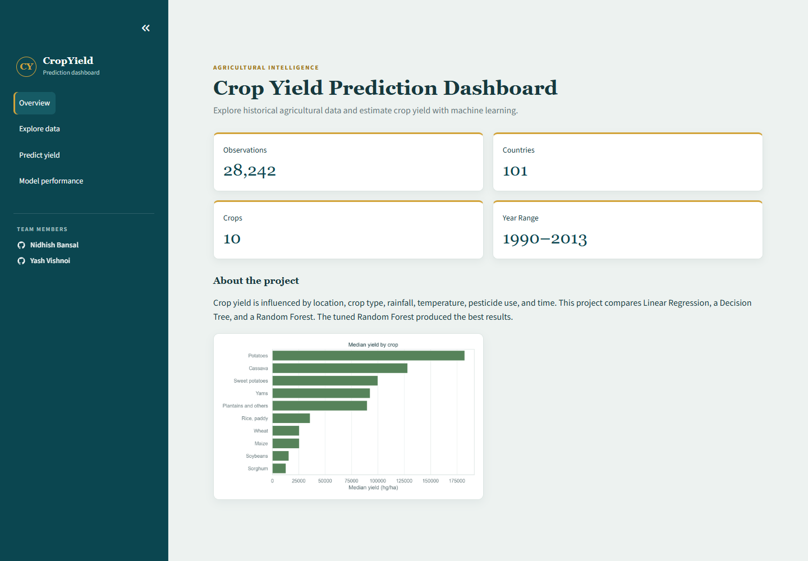
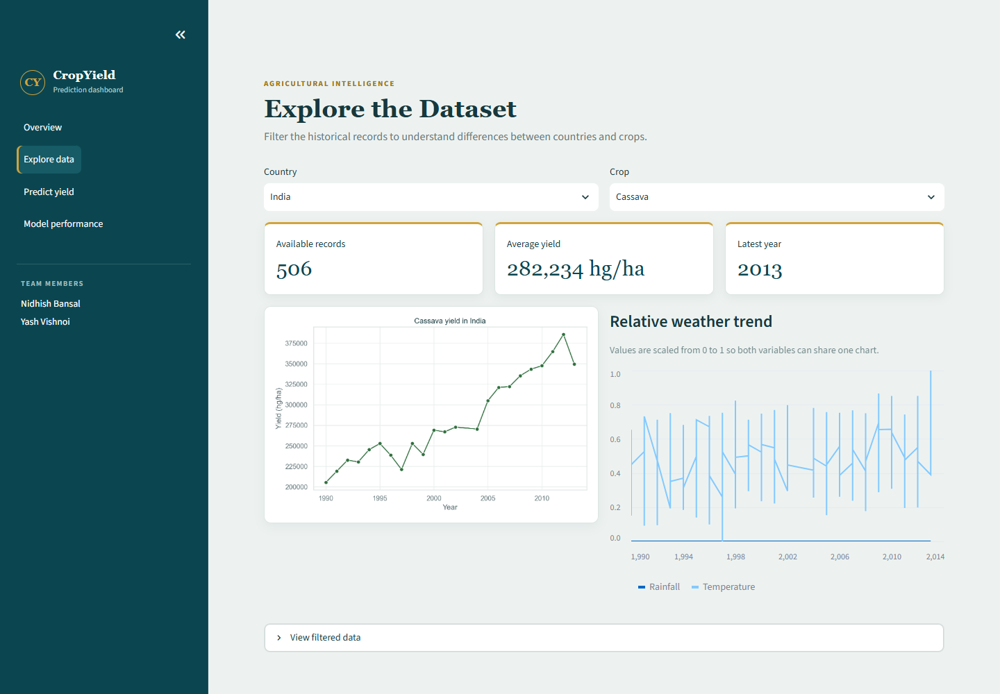

# Crop Yield Prediction

[**Open the live CropCast ML dashboard →**](https://cropcast-ml.streamlit.app/)

This BTech Machine Learning lab project uses historical agricultural and weather data to predict crop yield. It demonstrates the complete machine learning workflow, including data cleaning, exploratory data analysis, preprocessing, model training, hyperparameter tuning, evaluation, interpretation, and an interactive Streamlit dashboard.

## Team Members

- Nidhish Bansal
- Yash Vishnoi

## Dashboard Preview

These screenshots show the original dashboard. The current app also includes the advanced-model selector and comparison described below.

<table>
  <tr>
    <td width="50%">
      <strong>Project Overview</strong><br>
      
    </td>
    <td width="50%">
      <strong>Explore Data</strong><br>
      
    </td>
  </tr>
  <tr>
    <td width="50%">
      <strong>Predict Yield</strong><br>
      
    </td>
    <td width="50%">
      <strong>Model Performance</strong><br>
      
    </td>
  </tr>
</table>

## Project Objective

Crop yield depends on several factors, such as rainfall, temperature, pesticide usage, crop type, location, and year. The objective of this project is to compare multiple regression algorithms and identify the model that predicts crop yield most accurately.

The prediction target is `hg/ha_yield`, measured in hectograms per hectare.

> 10,000 hg/ha = 1 tonne/hectare

## Dataset

The merged dataset contains 28,242 observations covering:

- 101 countries
- 10 crops
- Years from 1990 to 2013
- Average annual rainfall
- Average temperature
- Pesticide usage
- Recorded crop yield

The `dataset` folder also contains the original yield, rainfall, temperature, and pesticide CSV files.

## Machine Learning Models

The original notebook compares three regression models:

1. Linear Regression
2. Decision Tree Regressor
3. Random Forest Regressor

The Random Forest is tuned using a small grid search with expanding-year validation.

### Advanced Models and Future Scenarios

[`Advanced_Crop_Yield_Prediction.ipynb`](Advanced_Crop_Yield_Prediction.ipynb) adds Histogram Gradient Boosting, Extra Trees, and a neural network with three hidden layers (128, 64, 32 neurons), alongside a freshly rerun Random Forest reference. It includes executed results, eight figures, simple explanations, and viva questions.

Model selection uses **1990–2005 training and 2006–2009 validation**. Final evaluation refits on **1990–2009** and tests on **2010–2013**.

| Model | Validation RMSE | Test MAE | Test RMSE | Test R² |
|---|---:|---:|---:|---:|
| Extra Trees | 16,102.478 | 10,152.975 | 19,942.622 | 0.956 |
| Neural Network | 18,661.863 | 11,221.705 | 19,397.042 | 0.959 |
| Histogram Gradient Boosting | 20,919.691 | 13,459.170 | 23,347.448 | 0.940 |
| Random Forest reference | 16,732.869 | 10,442.003 | 20,533.341 | 0.954 |

Errors are in hg/ha. **Extra Trees is the dashboard default** because it won on validation RMSE. The neural network had the lowest final-test RMSE, but the test period is not used to change the selected model. Extra Trees reduced test RMSE by 2.88% against this rerun reference. R² is not percentage accuracy.

The prediction page lets you choose any of these four models. It fits the requested model on all available 1990–2013 data and caches one fitted model at a time. Supply a year and weather/pesticide assumptions to obtain a conditional yield estimate. First-time training may take a minute. All models learn from history; a neural network does not guarantee reliable extrapolation beyond 2013.

[`advanced_future_yield_models.py`](advanced_future_yield_models.py) contains the standalone initial advanced experiment and reusable model definitions used by the dashboard. Its standalone winner is selected using test RMSE; use the separate notebook's earlier-validation procedure for the more defensible lab comparison.

### Temporal 1D CNN, Stacked Ensemble and Explainability

[`Temporal_CNN_Ensemble_Explainability.ipynb`](Temporal_CNN_Ensemble_Explainability.ipynb) adds a deep-learning model, ensembles and model explanations:

- **Cleaner data:** `yield_df.csv` repeats many country-crop-year rows, and only `avg_temp` differs between the copies. The notebook keeps one row per country-crop-year (13,130 rows) and averages the temperatures. The year 2003 is missing from the dataset, so it is interpolated, but only for use as a past input, never as a target.
- **Temporal 1D CNN (PyTorch):** reads the last five years of yield, rainfall, pesticides and temperature for each country-crop pair, plus country and crop embeddings and this year's inputs, and predicts this year's yield.
- **Fair comparison:** every model gets the same five-year lag features. A "last year's yield" baseline is also included.
- **Ensembles:** simple average, validation-weighted average and stacking (non-negative linear regression). All weights are learned on 2006–2009 only.
- **Explainability:** Grad-CAM and Integrated Gradients for the CNN, and SHAP for Extra Trees and the stacked ensemble.

Model selection trains on target years 1995–2005 and validates on 2006–2009. Final evaluation refits on 1995–2009 and tests on 2010–2013.

| Model | Validation RMSE | Test MAE | Test RMSE | Test R² |
|---|---:|---:|---:|---:|
| Extra Trees (selected) | 13,939.632 | 7,564.940 | 15,683.206 | 0.968 |
| Ensemble: weighted average | 14,046.984 | 7,594.922 | 15,590.177 | 0.968 |
| Ensemble: simple average | 14,064.615 | 7,633.135 | 15,610.054 | 0.968 |
| Ensemble: stacking | 14,197.194 | 7,401.997 | 15,454.882 | 0.969 |
| Last year's yield (baseline) | 14,657.148 | 7,766.018 | 16,738.258 | 0.964 |
| Temporal 1D CNN | 14,816.736 | 8,014.704 | 16,647.012 | 0.964 |
| Gradient Boosting | 14,919.482 | 8,029.653 | 16,420.802 | 0.965 |
| Neural Network (MLP) | 16,911.294 | 9,624.132 | 17,669.333 | 0.959 |
| Extra Trees (no lags) | 20,510.735 | 10,544.429 | 20,941.090 | 0.943 |

Extra Trees with lag features is selected because it has the lowest validation RMSE. The stacked ensemble (68% Extra Trees, 28% CNN, 4% MLP) has the lowest test RMSE, but the test years are not used to change the choice. Past yields dominate every explanation, so the lag features are the main improvement (20,941 → 15,683 test RMSE for Extra Trees). The CNN beats the last-year baseline on test but not on validation. With about 10,000 samples it does not outperform the trees, though it still adds value inside the ensemble. These results use de-duplicated data, so they are not directly comparable with the tables above.

This notebook needs PyTorch and SHAP:

```bash
pip install -r requirements-deep.txt
```

## Evaluation

The models are tested using two approaches:

- **Random 80/20 split:** Measures performance on randomly selected historical records.
- **Time-based split:** Trains on 1990–2009 and tests on 2010–2013 to better represent future prediction.

The evaluation metrics are MAE, RMSE, and R².

### Original Notebook Results

| Evaluation split | Best model | MAE | RMSE | R² |
|---|---|---:|---:|---:|
| Random 80/20 | Tuned Random Forest | 3,452.628 | 9,419.223 | 0.988 |
| Time 2010–2013 | Tuned Random Forest | 10,321.933 | 20,371.908 | 0.955 |

The Random Forest performed best because it captured nonlinear relationships while reducing the overfitting seen in a single Decision Tree. The time-based split produced a larger error because predicting future years is more difficult and realistic than predicting randomly selected historical records.

## How to Run

1. Clone the repository:

   ```bash
   git clone https://github.com/Nidhish01/Crop-Yield-Prediction.git
   cd Crop-Yield-Prediction
   ```

2. Install the required Python packages:

   ```bash
   pip install -r requirements.txt
   ```

3. Start Jupyter Notebook:

   ```bash
   jupyter notebook
   ```

4. Open `Crop_Yield_Prediction.ipynb` or `Advanced_Crop_Yield_Prediction.ipynb` and select **Run All**.

### Run the Streamlit Dashboard

```bash
streamlit run app.py
```

The dashboard provides four sections:

- Project summary and dataset statistics
- Country- and crop-based data exploration
- Interactive crop-yield prediction with an advanced-model selector
- Original and advanced model-performance comparisons

## Repository Structure

```text
Crop-Yield-Prediction/
|-- .streamlit/
|   `-- config.toml
|-- Crop_Yield_Prediction.ipynb
|-- Advanced_Crop_Yield_Prediction.ipynb
|-- Temporal_CNN_Ensemble_Explainability.ipynb
|-- advanced_future_yield_models.py
|-- app.py
|-- README.md
|-- requirements.txt
|-- requirements-deep.txt
|-- output/
|   |-- temporal_cnn_ensemble_results.csv
|   `-- pdf/Crop_Yield_Project_Viva_Guide.pdf
|-- screenshots/
|   |-- overview.png
|   |-- explore-data.png
|   |-- predict-yield.png
|   `-- model-performance.png
`-- dataset/
    |-- yield_df.csv
    |-- yield.csv
    |-- rainfall.csv
    |-- temp.csv
    `-- pesticides.csv
```

## Limitations

- The weather values are annual averages and do not capture seasonal conditions or extreme events.
- Important factors such as soil quality, irrigation, fertilizer use, and crop variety are unavailable.
- This is an educational prediction project, not a production agricultural advisory system.
