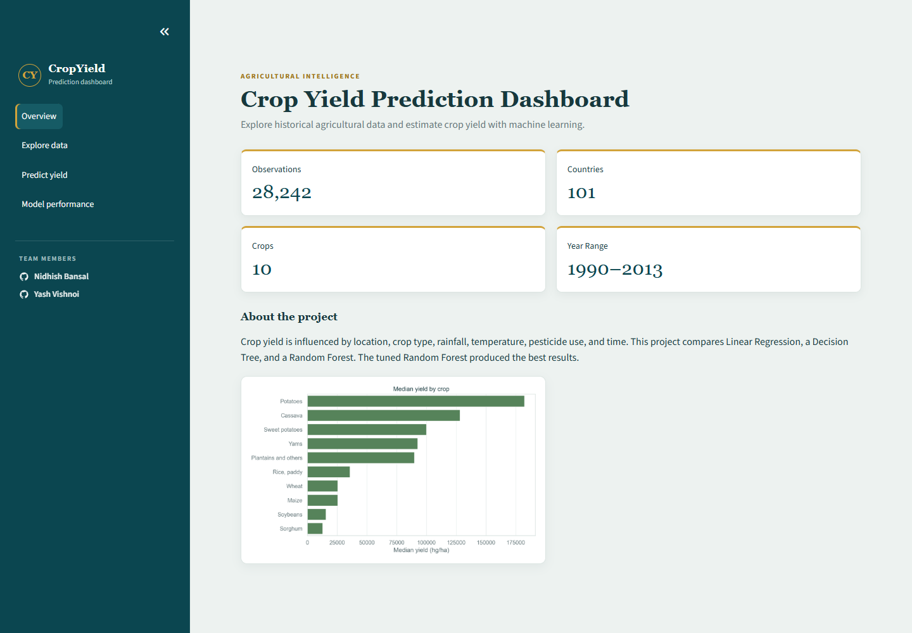
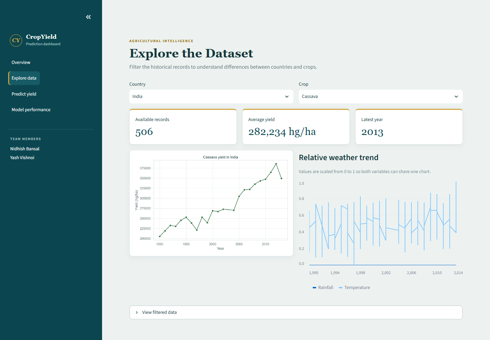
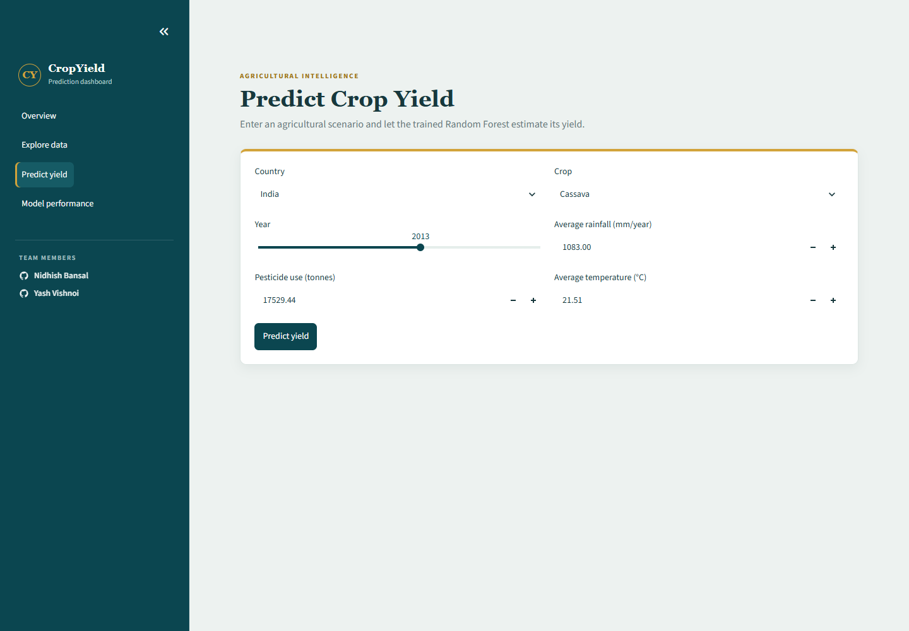
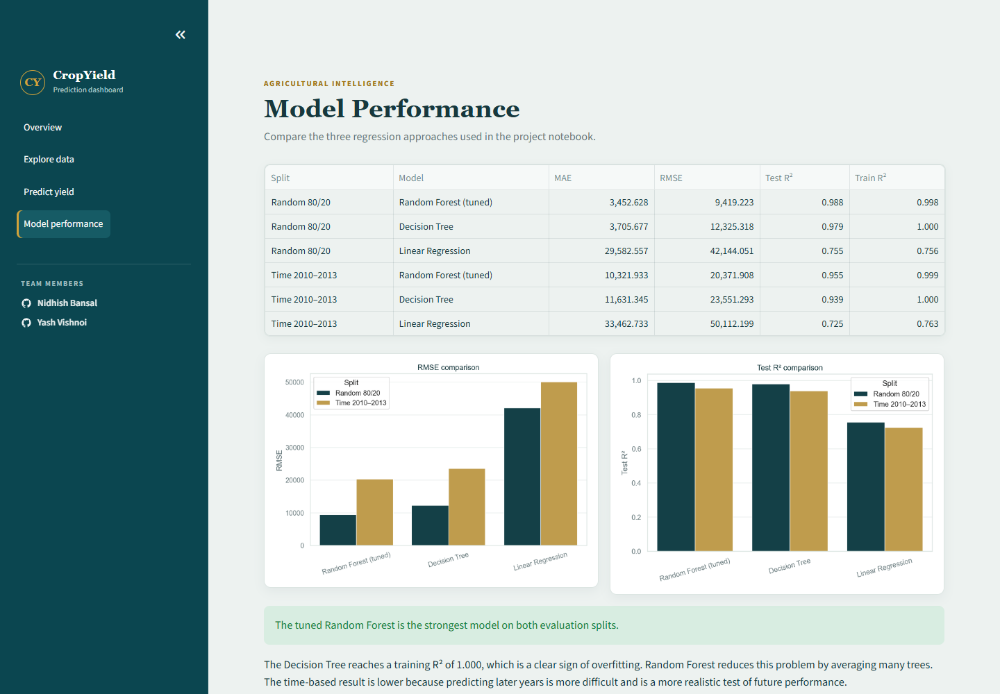

# Crop Yield Prediction

[**Open the live CropCast ML dashboard →**](https://cropcast-ml.streamlit.app/)

This BTech Machine Learning lab project uses historical agricultural and weather data to predict crop yield. It demonstrates the complete machine learning workflow, including data cleaning, exploratory data analysis, preprocessing, model training, hyperparameter tuning, evaluation, interpretation, and an interactive Streamlit dashboard.

## Team Members

- Nidhish Bansal
- Yash Vishnoi

## Dashboard Preview

<table>
  <tr>
    <td width="50%">
      <strong>Project Overview</strong><br>
      
    </td>
    <td width="50%">
      <strong>Explore Data</strong><br>
      
    </td>
  </tr>
  <tr>
    <td width="50%">
      <strong>Predict Yield</strong><br>
      
    </td>
    <td width="50%">
      <strong>Model Performance</strong><br>
      
    </td>
  </tr>
</table>

## Project Objective

Crop yield depends on several factors, such as rainfall, temperature, pesticide usage, crop type, location, and year. The objective of this project is to compare multiple regression algorithms and identify the model that predicts crop yield most accurately.

The prediction target is `hg/ha_yield`, measured in hectograms per hectare.

> 10,000 hg/ha = 1 tonne/hectare

## Dataset

The merged dataset contains 28,242 observations covering:

- 101 countries
- 10 crops
- Years from 1990 to 2013
- Average annual rainfall
- Average temperature
- Pesticide usage
- Recorded crop yield

The `dataset` folder also contains the original yield, rainfall, temperature, and pesticide CSV files.

## Machine Learning Models

Three regression models are compared:

1. Linear Regression
2. Decision Tree Regressor
3. Random Forest Regressor

The Random Forest is tuned using a small grid search with expanding-year validation.

## Evaluation

The models are tested using two approaches:

- **Random 80/20 split:** Measures performance on randomly selected historical records.
- **Time-based split:** Trains on 1990–2009 and tests on 2010–2013 to better represent future prediction.

The evaluation metrics are MAE, RMSE, and R².

### Main Results

| Evaluation split | Best model | MAE | RMSE | R² |
|---|---|---:|---:|---:|
| Random 80/20 | Tuned Random Forest | 3,452.628 | 9,419.223 | 0.988 |
| Time 2010–2013 | Tuned Random Forest | 10,321.933 | 20,371.908 | 0.955 |

The Random Forest performed best because it captured nonlinear relationships while reducing the overfitting seen in a single Decision Tree. The time-based split produced a larger error because predicting future years is more difficult and realistic than predicting randomly selected historical records.

## How to Run

1. Clone the repository:

   ```bash
   git clone https://github.com/Nidhish01/Crop-Yield-Prediction.git
   cd Crop-Yield-Prediction
   ```

2. Install the required Python packages:

   ```bash
   pip install -r requirements.txt
   ```

3. Start Jupyter Notebook:

   ```bash
   jupyter notebook
   ```

4. Open `Crop_Yield_Prediction.ipynb` and select **Run All**.

### Run the Streamlit Dashboard

```bash
streamlit run app.py
```

The dashboard provides four sections:

- Project summary and dataset statistics
- Country- and crop-based data exploration
- Interactive crop-yield prediction
- Model-performance comparison

## Repository Structure

```text
Crop-Yield-Prediction/
|-- .streamlit/
|   `-- config.toml
|-- Crop_Yield_Prediction.ipynb
|-- app.py
|-- README.md
|-- requirements.txt
|-- screenshots/
|   |-- overview.png
|   |-- explore-data.png
|   |-- predict-yield.png
|   `-- model-performance.png
`-- dataset/
    |-- yield_df.csv
    |-- yield.csv
    |-- rainfall.csv
    |-- temp.csv
    `-- pesticides.csv
```

## Limitations

- The weather values are annual averages and do not capture seasonal conditions or extreme events.
- Important factors such as soil quality, irrigation, fertilizer use, and crop variety are unavailable.
- This is an educational prediction project, not a production agricultural advisory system.
