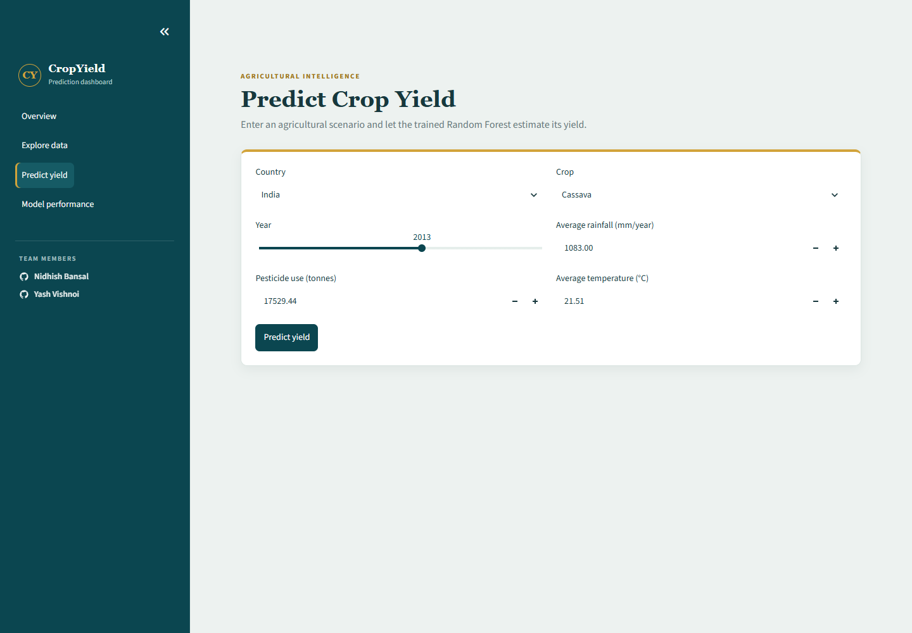
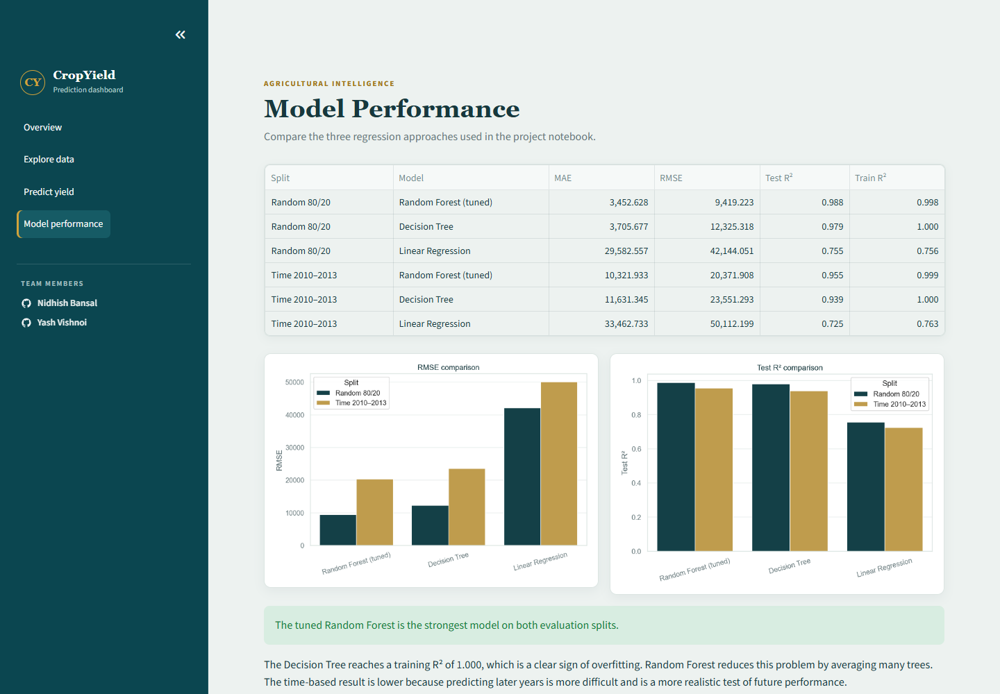

# Crop Yield Prediction

[**Open the live CropCast ML dashboard →**](https://cropcast-ml.streamlit.app/)

This BTech Machine Learning lab project uses historical agricultural and weather data to predict crop yield. It demonstrates the complete machine learning workflow, including data cleaning, exploratory data analysis, preprocessing, model training, hyperparameter tuning, evaluation, interpretation, and an interactive Streamlit dashboard.

## Team Members

- Nidhish Bansal
- Yash Vishnoi

## UML501 Submission Files

- [Project report (PDF)](output/pdf/Crop_Yield_Prediction_UML501_Report_Revised.pdf)
- [Project presentation (PowerPoint)](Crop_Yield_Prediction_UML501.pptx)

## Dashboard Preview

These screenshots show the original dashboard. The current app also includes the advanced-model and ensemble selector, SHAP explanations, and the comparisons described below.

<table>
  <tr>
    <td width="50%">
      <strong>Project Overview</strong><br>
      
    </td>
    <td width="50%">
      <strong>Explore Data</strong><br>
      
    </td>
  </tr>
  <tr>
    <td width="50%">
      <strong>Predict Yield</strong><br>
      
    </td>
    <td width="50%">
      <strong>Model Performance</strong><br>
      
    </td>
  </tr>
</table>

## Project Objective

Crop yield depends on several factors, such as rainfall, temperature, pesticide usage, crop type, location, and year. The objective of this project is to compare multiple regression algorithms and identify the model that predicts crop yield most accurately.

The prediction target is `hg/ha_yield`, measured in hectograms per hectare.

> 10,000 hg/ha = 1 tonne/hectare

## Dataset

The merged dataset contains 28,242 observations covering:

- 101 countries
- 10 crops
- Years from 1990 to 2013
- Average annual rainfall
- Average temperature
- Pesticide usage
- Recorded crop yield

The `dataset` folder also contains the original yield, rainfall, temperature, and pesticide CSV files.

## Machine Learning Models

The original notebook compares three regression models:

1. Linear Regression
2. Decision Tree Regressor
3. Random Forest Regressor

The Random Forest is tuned using a small grid search with expanding-year validation.

### Advanced Models and Future Scenarios

[`Advanced_Crop_Yield_Prediction.ipynb`](Advanced_Crop_Yield_Prediction.ipynb) adds Histogram Gradient Boosting, Extra Trees, and a neural network with three hidden layers (128, 64, 32 neurons), alongside a freshly rerun Random Forest reference. It includes executed results, eight figures, simple explanations, and viva questions.

Model selection uses **1990–2005 training and 2006–2009 validation**. Final evaluation refits on **1990–2009** and tests on **2010–2013**.

| Model | Validation RMSE | Test MAE | Test RMSE | Test R² |
|---|---:|---:|---:|---:|
| Extra Trees | 16,102.478 | 10,152.975 | 19,942.622 | 0.956 |
| Neural Network | 18,661.863 | 11,221.705 | 19,397.042 | 0.959 |
| Histogram Gradient Boosting | 20,919.691 | 13,459.170 | 23,347.448 | 0.940 |
| Random Forest reference | 16,732.869 | 10,442.003 | 20,533.341 | 0.954 |

Errors are in hg/ha. **Extra Trees is the dashboard default** because it won on validation RMSE. The neural network had the lowest final-test RMSE, but the test period is not used to change the selected model. Extra Trees reduced test RMSE by 2.88% against this rerun reference. R² is not percentage accuracy.

The prediction page lets you choose any of these four models, or one of the ensembles below. It fits the requested model on all available 1990–2013 data and caches one fitted model at a time. Supply a year and weather/pesticide assumptions to obtain a conditional yield estimate. First-time training may take a minute. All models learn from history; a neural network does not guarantee reliable extrapolation beyond 2013.

[`advanced_future_yield_models.py`](advanced_future_yield_models.py) contains the standalone initial advanced experiment and reusable model definitions used by the dashboard. Its standalone winner is selected using test RMSE; use the separate notebook's earlier-validation procedure for the more defensible lab comparison.

## Ensembles and Explainability

[`Ensemble_and_Explainability.ipynb`](Ensemble_and_Explainability.ipynb) combines the three advanced models into ensembles and explains their predictions with SHAP. The reusable code lives in [`ensemble_models.py`](ensemble_models.py) (run `python ensemble_models.py` to reproduce the table) and [`explainability.py`](explainability.py).

### Ensembles

- **Simple Average:** each base model (Extra Trees, Histogram Gradient Boosting, Neural Network) gets weight 1/3.
- **Weighted Average:** weights proportional to 1 / validation RMSE² (inverse-variance weighting).
- **Stacking:** a `LinearRegression(positive=True)` meta-model learns how to combine out-of-fold base predictions. The out-of-fold predictions come from expanding-window, two-year time folds: each block of years is predicted by base models trained only on earlier years.

The protocol is the same as for the advanced models. Weights, the meta-model and model selection use **1990–2005 training and 2006–2009 validation**. The final models are refitted on **1990–2009** and tested on **2010–2013**, which are never used to choose weights or models.

| Model | Type | Validation RMSE | Test MAE | Test RMSE | Test R² |
|---|---|---:|---:|---:|---:|
| Stacking | Ensemble | 15,616.21 | 9,273.16 | 18,270.33 | 0.9634 |
| Extra Trees | Base | 16,102.48 | 10,152.98 | 19,942.62 | 0.9564 |
| Weighted Average | Ensemble | 16,687.65 | 10,049.13 | 18,655.47 | 0.9619 |
| Simple Average | Ensemble | 17,023.91 | 10,326.79 | 18,818.90 | 0.9612 |
| Neural Network (MLP) | Base | 18,661.86 | 11,221.70 | 19,397.04 | 0.9588 |
| Histogram Gradient Boosting | Base | 20,919.69 | 13,459.17 | 23,347.45 | 0.9403 |

Errors are in hg/ha, sorted by validation RMSE. **Stacking is the best model by validation RMSE** and also has the lowest test MAE and RMSE (8.4% lower test RMSE than Extra Trees). The Weighted Average validation RMSE is slightly optimistic because its weights were computed from those same validation years.

| Base model | Weighted Average weight | Stacking coefficient |
|---|---:|---:|
| Extra Trees | 0.4279 | 0.8156 |
| Histogram Gradient Boosting | 0.2535 | 0.0000 |
| Neural Network (MLP) | 0.3186 | 0.2081 |
| Intercept | – | 618.15 |

The stacking meta-model relies mostly on Extra Trees, adds a smaller neural-network share, and gives Gradient Boosting no weight.

### SHAP explanations

SHAP splits one prediction into a contribution (in hg/ha) per input: `base value + sum of SHAP values = prediction`, where the base value is the average prediction over a background sample.

- **Model-agnostic (`explain_model`):** used for the ensembles and the neural network. It only calls `predict` on the 6 original features, so with 2⁶ = 64 feature subsets it computes **exact** Shapley values (`shap.explainers.Exact`) against a 50-row background sample.
- **Tree models (`explain_tree_pipeline`):** `shap.TreeExplainer` on the fitted trees; one-hot columns are summed back into Country and Crop. The Extra Trees grow to depth 65–80 (no `max_depth`), where the default path-dependent algorithm breaks down numerically (additivity errors of 10³–10⁹ hg/ha). The **interventional** algorithm with a small background sample stays exact (error < 0.01 hg/ha) and is faster, so it is used for deep forests.

The notebook shows global importance, beeswarm, dependence and waterfall plots. SHAP describes how a model uses its inputs, not what causes crop yield.

## Evaluation

The models are tested using two approaches:

- **Random 80/20 split:** Measures performance on randomly selected historical records.
- **Time-based split:** Trains on 1990–2009 and tests on 2010–2013 to better represent future prediction.

The evaluation metrics are MAE, RMSE, and R².

### Original Notebook Results

| Evaluation split | Best model | MAE | RMSE | R² |
|---|---|---:|---:|---:|
| Random 80/20 | Tuned Random Forest | 3,452.628 | 9,419.223 | 0.988 |
| Time 2010–2013 | Tuned Random Forest | 10,321.933 | 20,371.908 | 0.955 |

The Random Forest performed best because it captured nonlinear relationships while reducing the overfitting seen in a single Decision Tree. The time-based split produced a larger error because predicting future years is more difficult and realistic than predicting randomly selected historical records.

## How to Run

1. Clone the repository:

   ```bash
   git clone https://github.com/Nidhish01/Crop-Yield-Prediction.git
   cd Crop-Yield-Prediction
   ```

2. Install the required Python packages:

   ```bash
   pip install -r requirements.txt
   ```

3. Start Jupyter Notebook:

   ```bash
   jupyter notebook
   ```

4. Open `Crop_Yield_Prediction.ipynb`, `Advanced_Crop_Yield_Prediction.ipynb`, or `Ensemble_and_Explainability.ipynb` and select **Run All**.

To reproduce the ensemble results from the command line:

```bash
python ensemble_models.py
```

### Run the Streamlit Dashboard

```bash
streamlit run app.py
```

The dashboard provides four sections:

- Project summary and dataset statistics
- Country- and crop-based data exploration
- Interactive crop-yield prediction with an advanced-model and ensemble selector, plus a SHAP waterfall and plain-English explanation of each prediction
- Original, advanced and ensemble model-performance comparisons

Extra Trees remains the default prediction model. Stacking has the best validation RMSE but takes the longest to train (15 model fits), so its first prediction can take a few minutes.

## Repository Structure

```text
Crop-Yield-Prediction/
|-- .streamlit/
|   `-- config.toml
|-- Crop_Yield_Prediction.ipynb
|-- Advanced_Crop_Yield_Prediction.ipynb
|-- Ensemble_and_Explainability.ipynb
|-- advanced_future_yield_models.py
|-- ensemble_models.py
|-- explainability.py
|-- app.py
|-- README.md
|-- requirements.txt
|-- output/
|   `-- pdf/Crop_Yield_Project_Viva_Guide.pdf
|-- screenshots/
|   |-- overview.png
|   |-- explore-data.png
|   |-- predict-yield.png
|   `-- model-performance.png
`-- dataset/
    |-- yield_df.csv
    |-- yield.csv
    |-- rainfall.csv
    |-- temp.csv
    `-- pesticides.csv
```

## Limitations

- The weather values are annual averages and do not capture seasonal conditions or extreme events.
- Important factors such as soil quality, irrigation, fertilizer use, and crop variety are unavailable.
- This is an educational prediction project, not a production agricultural advisory system.
